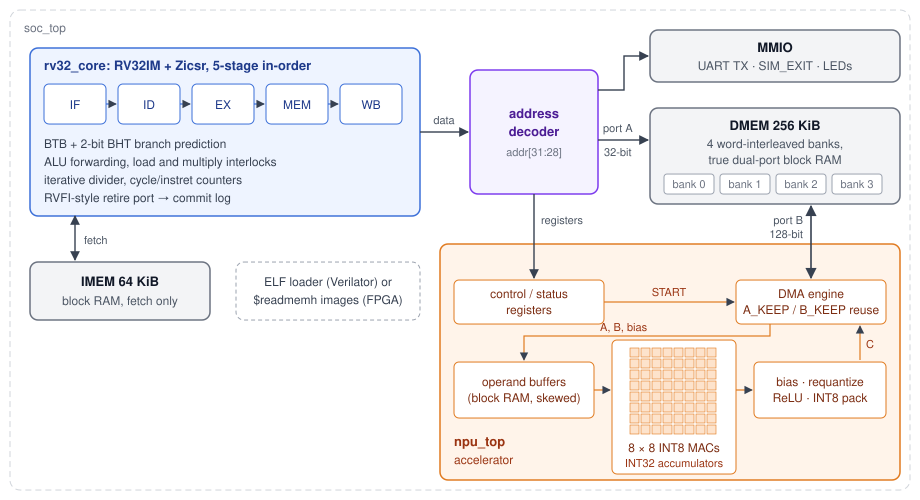

# Pulse

[](https://github.com/MatiiiBL/riscv-npu-soc/actions/workflows/ci.yml)

**A RISC-V system-on-chip with a neural-network accelerator, written in SystemVerilog.**
A 5-stage pipelined RV32IM CPU drives an 8 x 8 INT8 systolic array (a small
TPU-style matrix engine) that has its own DMA engine. The design is checked
instruction by instruction against a C++ reference simulator, runs quantized
MNIST, GEMM and CoreMark firmware built with clang, and closes timing at
40 MHz on a Lattice ECP5 FPGA with a fully open-source flow.

Measured on the RTL (Verilator, cycle-accurate), with times at the 40 MHz FPGA clock:

- **MNIST inference is 115x faster on the NPU than on the CPU alone:** 76 µs instead of
  8.8 ms per image. The CPU-only and NPU paths give bit-identical results, and both match
  a bit-exact Python INT8 model. That model scores **98.07%** on the 10,000-image test set
  (98.06% in floating point).
- **Matrix multiply runs 30-100x faster** than an optimized software loop on the same core.
  The NPU sustains up to **58.9 of its 64 MACs per cycle** on a full tile.
- **The CPU scores 2.86 CoreMark/MHz (114 CoreMark/s at 40 MHz).** It has full forwarding
  and a BTB + 2-bit branch predictor, which mispredicts 9.7% of CoreMark's branches.
- **Timing closure took the FPGA clock from 25 to 40 MHz** (Fmax 42-46.5 MHz over 8
  place-and-route seeds). That traded 15% CPI for a 1.6x clock, a net **1.39x faster on
  CoreMark and 1.59x on MNIST**.
- **The design is verified at four levels:** all 48 applicable official riscv-tests, 32
  directed pipeline tests, constrained-random differential testing against the reference
  simulator (thousands of programs, compared at every retired instruction), and cocotb
  tests of the NPU against a Python golden model in 6 configurations. CI runs all of it
  on every push.



## Contents

- [Results](#results)
- [Quick start](#quick-start)
- [How it works](#how-it-works)
- [Verification](#verification)
- [Design decisions](#design-decisions)
- [Repository layout](#repository-layout)
- [Limitations and next steps](#limitations-and-next-steps)

## Results

The benchmarks run on the Verilator model of the full SoC (`make bench`). Cycle counts
are exact, and times assume the 40 MHz clock the FPGA build meets. The CPU baselines are
the same kernels in plain C, compiled with clang `-O2` for RV32IM and checked for equal
output.

### NPU vs. CPU

| Workload | CPU only | CPU + NPU | Speedup |
|----------|---------:|----------:|--------:|
| MNIST MLP 784-128-10, per image (batch 8) | 351,905 cycles (8.80 ms) | 3,053 cycles (76.3 µs) | **115x** |
| GEMM 16 x 16 x 2048 (K split across commands) | 1,777,955 | 17,766 | **100x** |
| GEMM 64 x 64 x 256, INT8 out, requantized | 3,812,349 | 38,937 | **98x** |
| GEMM 64 x 64 x 256, INT32 out | 3,670,955 | 38,929 | **94x** |
| GEMM 64 x 64 x 64 | 1,016,747 | 19,614 | **52x** |
| GEMM 32 x 32 x 32 | 143,867 | 4,292 | **34x** |
| GEMM 8 x 8 x 64 (a single tile) | 16,061 | 527 | **30x** |

The software loop reaches 0.23-0.29 multiply-accumulates (MACs) per cycle. End to end,
including the driver and register writes, the NPU reaches up to 29.5 MACs per cycle.
Small GEMMs are dominated by driver overhead, and large ones by moving operands. Getting
there took two hardware changes, measured on an 8 x 8 x 1024 tile:

| NPU configuration | Cycles | MACs / cycle |
|-------------------|-------:|-------------:|
| 4-byte DMA port | 5,209 | 12.6 |
| 16-byte DMA port (banked DMEM) | 2,137 | 30.7 |
| + operand reuse (`B_KEEP`) | 1,625 | 40.3 |
| + operand reuse (`A_KEEP` and `B_KEEP`) | 1,113 | **58.9** (of 64) |

### CPU

| CoreMark (10 iterations) | Branch prediction on | Off (static not-taken) |
|--------------------------|---------------------:|-----------------------:|
| CoreMark / MHz | **2.855** | 2.453 |
| CPI | 1.345 | 1.566 |
| CoreMark / s at 40 MHz | **114** | 98 |

### FPGA: Radiona ULX3S (Lattice LFE5U-85F, speed grade 6)

| | |
|---|---|
| Clock | **40 MHz** from the on-chip PLL. Fmax is 42.1-46.5 MHz over 8 nextpnr seeds. |
| LUT4 | 15,098 (18.1%) |
| Flip-flops | 7,025 (8.4%) |
| Block RAM (DP16KD) | 173 of 208 (83%): 128 DMEM, 29 IMEM, 16 NPU buffers |
| Multipliers (MULT18X18D) | 70 of 156 (45%): 64 PEs, 2 requantization, 4 CPU |

The first version closed timing at only 25 MHz. Every critical path started at a block
RAM output, and they were removed one at a time ([details](docs/core.md#10-clock-frequency-and-cpi)):

| Step | Change | Fmax (MHz) |
|------|--------|-----------:|
| 0 | baseline: load data forwarded from WB straight into a single-cycle 33 x 33 multiply | 26.3-27.8 |
| 1 | multiply moved to MEM behind a one-cycle interlock | 27.3-28.3 |
| 2 | load data no longer forwarded from the RAM output | 33.6-38.4 |
| 3 | IMEM fetches every cycle, with a skid register for stalls | 36.0-40.0 |
| 4 | BTB in LUT RAM, predicted-target check moved to EX | 40.1-44.0 |
| 5 | hazard interlock as a one-hot scoreboard lookup | 43.7-46.3 |

One alternative was measured and rejected: forwarding load data to ALU consumers only.
It cut CPI to 1.29 but capped Fmax at about 38 MHz, about 104 CoreMark/s at a safe
clock, against 114 for the chosen design.

## Quick start

**Prerequisites.**
- **macOS:** `brew install verilator yosys llvm lld python`. Apple clang has no RISC-V
  target, so the build uses Homebrew's LLVM.
- **Ubuntu 24.04:** `sudo apt install clang lld llvm python3-venv`, plus Verilator
  5.036 or newer and Yosys. The [OSS CAD Suite](https://github.com/YosysHQ/oss-cad-suite-build/releases)
  has both, and it also has nextpnr for the FPGA build.

```sh
git clone --recursive https://github.com/MatiiiBL/riscv-npu-soc.git
cd riscv-npu-soc
make venv            # Python venv for cocotb, numpy and the MNIST scripts
make test            # every suite below; about 7 minutes on a laptop

make sim sw          # Verilator model of the SoC and all firmware
build/sim/soc_sim build/sw/hello.elf             # UART output goes to stdout
build/sim/soc_sim --stats build/sw/coremark.elf  # CPI, stalls, mispredicts
build/sim/soc_sim build/sw/mnist.elf             # CPU vs NPU on 100 MNIST images
make bench           # writes build/bench/results.md
```

Every simulator takes `--commit-log FILE`, which writes one line per retired
instruction. `soc_sim` also takes `--vcd FILE` for waveforms. To build a bitstream,
put the OSS CAD Suite on your `PATH` (or set `OSS_CAD_SUITE`), then run
`make -C fpga FW=mnist` and `make -C fpga report`. To flash a board, run
`make -C fpga prog`.

## How it works

The design contract is [`docs/spec.md`](docs/spec.md). It covers the memory map, bus
timing, NPU registers and their exact semantics, the simulator command line and the
commit-log format. Every block, model and test is written against it. Deeper write-ups:
[core](docs/core.md), [NPU](docs/npu.md), [software](docs/software.md),
[verification](docs/verification.md), [FPGA](docs/fpga.md).

**CPU** (`rtl/core/`). The CPU is an in-order IF / ID / EX / MEM / WB pipeline
implementing RV32IM and the Zicsr counters.
- **Forwarding:** ALU results are forwarded from MEM and WB.
- **Interlocks:** loads and multiplies are interlocked. A load's value reaches its
  consumer through the register file's write-before-read, which keeps block RAM out of
  the forwarding path.
- **Branch prediction:** a 64-entry BTB with 2-bit counters predicts at fetch, and
  branches resolve in EX.
- **Divide:** the divider is iterative and stalls the pipeline.
- **Retire port:** an RVFI-style retirement port reports every retired instruction, and
  the testbench turns it into a commit log.
- **No traps:** ECALL, EBREAK, illegal instructions and bad fetches halt the core, and
  the simulators report each kind of halt with its own exit code.

**NPU** (`rtl/npu/`). The NPU is an 8 x 8 grid of INT8 x INT8 -> INT32
multiply-accumulate cells.
- **Dataflow:** the array is output-stationary. Rows of A and B stream through it, and
  each cell keeps its own output's sum.
- **Skew:** the systolic skew comes from offsetting each operand-buffer bank's read
  address by its row index, not from a triangle of delay registers.
- **Commands:** one command computes an output tile of `C = A x B^T`. The driver tiles
  larger matrices.
  - B is stored N x K, the natural layout of a fully connected layer's weights, so no
    transpose is needed.
  - `ACC_KEEP` and `NO_WB` split K across commands.
  - `A_KEEP` and `B_KEEP` skip reloading an operand the NPU already holds.
- **Write-back:** a pipelined stage adds the bias, requantizes (`(acc + bias) x
  multiplier >> shift`, rounded), applies ReLU, saturates and packs INT8 bytes with byte
  enables.

**SoC** (`rtl/soc/`). The memories are Harvard: 64 KiB of IMEM and 256 KiB of DMEM, all
block RAM.
- **DMEM** is four word-interleaved, true dual-port banks. The CPU uses one 32-bit port,
  and the NPU's DMA reads or writes 16 bytes per cycle on the other, so accelerator
  traffic never stalls the CPU.
- **Peripherals:** an address decoder also connects a UART transmitter, a simulation-exit
  register and the board LEDs.

**Software** (`sw/`, `models/mnist/`).
- **Toolchain:** firmware is bare-metal C built with clang and lld, with a small runtime
  (crt0, linker script, printf).
- **Driver:** the NPU driver tiles GEMMs, splits K, and orders loops so consecutive
  commands share an operand.
- **MNIST model:** a NumPy script trains the MLP. Post-training quantization makes it
  symmetric INT8 with per-layer requantization that matches the NPU's arithmetic, and the
  weights are exported as C headers.

## Verification

Everything below runs in `make test` and in CI ([details](docs/verification.md)):

| Level | What it checks |
|-------|----------------|
| **Reference simulator** (`tools/iss/`) | A C++ model of the whole SoC: RV32IM, memory map, UART and a functional NPU. It is the golden model; 836 unit-test checks cover it. |
| **ISA compliance** | All 48 rv32ui and rv32um riscv-tests (`fence_i` and misaligned accesses excluded by design) pass on the ISS and on the RTL. |
| **Directed pipeline tests** (`verif/core/`) | 32 tests target hazards the compliance suite does not stress: forwarding into every operand, load- and multiply-use, divider stalls, BTB aliasing, bad fetches, UART output at a cycle budget. Every test that does not read the cycle counter is also compared against the ISS. |
| **Random differential testing** (`tools/rvgen/`, `tools/difftest.py`) | Constrained-random RV32IM programs (hazard-dense sequences, M-extension corner operands, every load and store width, MMIO and NPU registers, unmapped addresses, halting endings) run on the RTL and the ISS. Their commit logs (PC, instruction, register write, memory access) must match line for line. |
| **NPU unit tests** (`verif/npu/`) | 19 cocotb tests per configuration, bit-exact against a Python model of the spec: random shapes, every control flag, requantization edge cases, error paths, overlapping buffers, byte enables, a 300-operation random regression. They run in 6 array and port configurations. |
| **Firmware tests** (`sw/tests/`) | 11 programs, including NPU GEMM, K splitting, concurrent CPU and NPU traffic, and DMA past the end of memory. Their output must match `expected.txt` on the ISS and on several RTL builds. The NPU driver is also swept over array sizes 1-8 and six KMAX values. |
| **Variant checks** | The two predictor builds behave identically on 74 programs. A build with random initial state passes the suites. The real 8N1 UART is decoded bit by bit. |

The tests were also tested. Bugs were injected on purpose: 23 in the NPU RTL, plus
mutations of the ISS and the driver. The NPU suite caught 22 of the 23; the survivor
writes a word that is always overwritten or never read, so it is harmless. Two
independent review passes then looked for what the suites could not reach. They found
and fixed a disagreement in when the NPU reads the bias, a portability bug in the
driver, loader and command-line mismatches between the simulators, and tests that could
pass without checking anything.

## Design decisions

- **A written spec, then two independent implementations.** The RTL and the C++
  simulator are separate implementations of `docs/spec.md`. They are compared at every
  retired instruction, so a bug has to be made twice, in two languages, to go
  unnoticed. Every ambiguity the comparison exposed went back into the spec, for
  example what `instret` reads, how unmapped addresses behave, and what a misaligned jump
  does.
- **Dual-ported, banked DMEM instead of a shared bus.** The NPU gets its own memory port,
  so its DMA never stalls the CPU. Interleaving DMEM across four banks widened that port
  to 16 bytes with no extra block RAM: 256 KiB is 128 DP16KD either way. That made
  MNIST on the NPU 1.9x faster.
- **Operand reuse checked in hardware.** `A_KEEP` and `B_KEEP` are hints. The NPU tags
  what each buffer holds (address, stride, rows, K) and reloads on any mismatch, so a
  wrong hint costs time, never correctness.
- **Clock over CPI.** Forwarding load data from block RAM put a RAM clock-to-out, bank
  steering, load alignment and an adder in one cycle. Routing loads through the register
  file instead costs 15% CPI on CoreMark and buys a 1.6x clock.
- **No traps.** Exceptions and interrupts would add a privilege model and a second set
  of control paths without helping the workloads. ECALL, EBREAK, illegal instructions
  and bad fetches halt the core instead. The spec records where this departs from the
  RISC-V privileged architecture.
- **LLVM instead of a GNU cross toolchain.** clang and lld come with a RISC-V backend on
  both macOS and Ubuntu, so the same flags build the firmware and the official
  riscv-tests everywhere, including CI.

## Repository layout

| Path | Contents |
|------|----------|
| `rtl/core/` | `rv32_core`: pipeline, decoder, ALU, multiply/divide, branch predictor |
| `rtl/npu/` | `npu_top`: register block, DMA, operand buffers, systolic array, write-back |
| `rtl/soc/` | `soc_top`, banked DMEM, IMEM, decoder, UART, MMIO |
| `sim/` | Verilator testbench: ELF loader, commit log, statistics, UART decoding |
| `tools/iss/` | C++ reference simulator with a functional NPU model |
| `tools/rvgen/`, `tools/difftest.py` | random program generator and RTL vs ISS comparison |
| `verif/` | riscv-tests environment, directed core tests, cocotb NPU tests, random flow |
| `sw/` | runtime, NPU driver, firmware tests, benchmarks (GEMM, MNIST, CoreMark) |
| `models/mnist/` | training, INT8 quantization and export of the MNIST model |
| `fpga/` | ULX3S board top, pin constraints, Yosys / nextpnr / ecppack flow |
| `docs/` | spec and design notes |

## Limitations and next steps

- **Not yet run on a physical board.** The bitstream builds, meets timing at 40 MHz,
  and its firmware runs in simulation with the board's real UART logic. Running on a
  ULX3S is the next step.
- **Simple memory system.** There are no caches, because block RAM answers in one cycle,
  and there is no external memory. A program and its data must fit in 64 KiB + 256 KiB,
  which is why the MNIST demo runs 100 test images in hardware and reports accuracy over
  all 10,000 from the bit-exact model.
- **The NPU runs one phase at a time.** Loading, computing and writing back happen in
  sequence. Double-buffering the operand banks, which are only half used at KMAX = 1024,
  would overlap the next load with the current compute.
- **Going past 40 MHz** needs a decoupled fetch queue (the critical path now runs from
  the IMEM output through decode to the stall) and a two-stage multiplier.
- **CoreMark** runs 10 iterations to keep simulation short, so the score is not a valid
  submission under CoreMark's run rules.

## License

[MIT](LICENSE). CoreMark (EEMBC) and riscv-tests are included as git submodules under
their own licenses.
